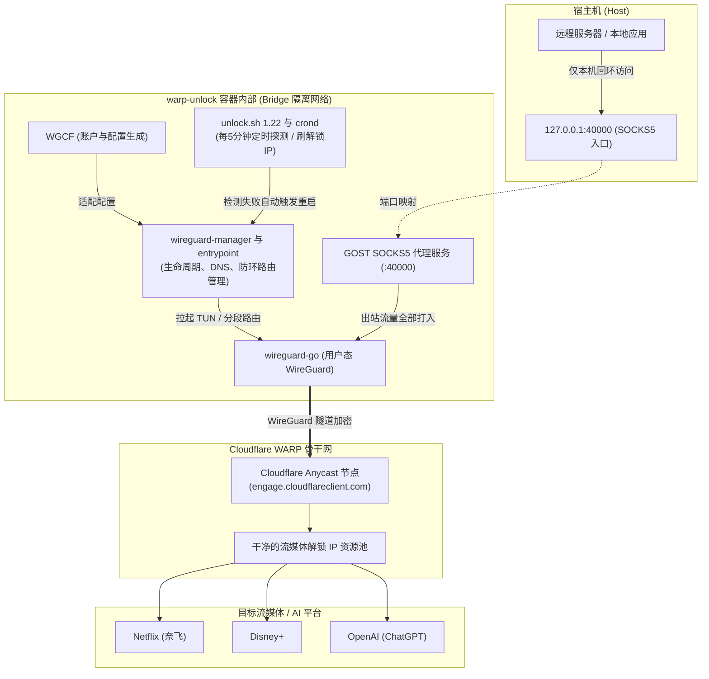
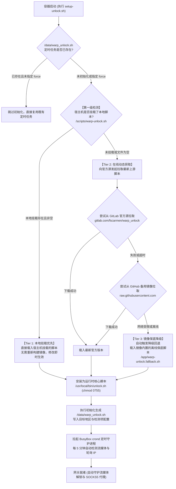

# WARP Unlock Docker (wireguard-go 用户态版)

[](https://alpinelinux.org/)
[](#)
[](https://git.zx2c4.com/wireguard-go)
[](#)
[](#)

专为 VPS / 云服务器打造的容器化无污染流媒体解锁网关。

基于 **Alpine 3.21 + WGCF + wireguard-go + GOST + unlock.sh** 构建，采用 **全用户态 WireGuard** 网络栈，彻底解耦宿主机 Linux 内核，在完全 **非特权（Non-Privileged）** 环境下实现 Netflix、Disney+、ChatGPT 等流媒体与 AI 服务的自动刷 IP 与安全代理。

---

## 🌟 核心特性

* 🛡️ **纯用户态网络栈 (`wireguard-go`)**：
  不依赖宿主机 `wireguard.ko` 内核模块，无需挂载 `/lib/modules`，杜绝一切特权（`privileged: false`），无论在 KVM、LXC、OpenVZ 还是云厂商定制精简内核机器上皆可 100% 稳定运行。
* ⚡ **极速精简瘦身（仅 ~48 MB）**：
  采用 Docker 多阶段构建（Multi-stage Build），剥离全部冗余 GNU 软件包，时区文件即拷即删，镜像体积由原来的 115 MB+ 腰斩至 **48 MB**，拉取与传输仅需 15 MB。
* 🔄 **原生兼容 fscarmen unlock.sh 刷 IP 逻辑**：
  内置自主编写的 `wg-quick` 兼容层包装器与进程生命周期管理器，上游脚本和定时任务（BusyBox `crond`）每 5 分钟自动检测解锁状态并无缝循环刷新高质量 IP。
* 🌐 **路由防环与 Docker 网络隔离**：
  * **Endpoint 静态直连**：强制 Cloudflare Anycast 对端走物理网关，彻底杜绝 UDP 报文打入隧道自身形成的死循环。
  * **SOCKS5 入站回程隔离**：设立专用策略路由，确保宿主机客户端请求响应原路返回 Docker 网桥，绝不误入 WARP。
  * **分段默认路由（`0.0.0.0/1` + `128.0.0.0/1`）**：全局出站走 WARP，同时完整保留容器原有网关。
* 🔒 **高安全性本地回环绑定**：
  GOST SOCKS5 默认严格绑定宿主机 `127.0.0.1:40000`，外网无法探测或扫描，杜绝被黑客白嫖或当作攻击跳板。
* 🛠️ **自主 DNS 管理**：
  剥离原 WGCF 配置中容易引发 Docker 只读文件报错的 `resolvconf` 逻辑，自主写入高可靠 Public DNS（`1.1.1.1` / `8.8.8.8`）。
* 🔀 **脚本三级平滑降级（Waterfall Fallback）**：
  启动时自动检测宿主机挂载（优先热加载修改）→ 缺失时在线拉取 GitLab/GitHub 最新版本 → 离线或断网时自动降级回退至镜像内置的稳定保底脚本，确保 100% 高可用。

---

## 🏗️ 架构拓扑图



---

## 🔄 解锁脚本加载与三级降级机制 (Waterfall Fallback)

为了兼顾 **本地灵活魔改**、**自动获取上游最新特性** 以及 **极端网络环境下的 100% 可用性**，容器启动阶段（`scripts/setup-unlock.sh`）引入了 **三级平滑降级（Waterfall Fallback）** 策略：

1. **第一优先级（宿主机挂载优先 · 本地即时生效）**：
   * 容器启动时检测是否挂载了宿主机的 `./scripts/warp-unlock.sh`。
   * 若存在且非空，则直接加载宿主机本地脚本。开发者可随意调试、改动或升级脚本，无需重新构建 Docker 镜像，修改立即可见。
2. **第二优先级（在线动态拉取最新版）**：
   * 若宿主机未挂载或本地脚本为空，容器启动时自动发起网络请求，优先从 GitLab 官方源拉取最新版 `unlock.sh`。
   * 若遇到网络波动或解析失败，自动无缝重试 GitHub 镜像源兜底。
3. **第三优先级（镜像内置保底降级）**：
   * 若遇到海外源被墙、DNS 污染、GitHub 限流或机器处于纯离线局域网环境导致在线拉取失败，系统 **自动触发降级回退机制**。
   * 直接加载在 Docker 构建阶段就已打包在镜像内部的稳定保底脚本（`/app/warp-unlock.fallback.sh`），保证容器即使完全断开外网也能 100% 成功启动完成初始化。



---

## 📁 目录结构

```text
warp-unlock-docker/
├── Dockerfile                   # 多阶段编译构建与瘦身定义
├── docker-compose.yml           # 容器服务编排（非特权、TUN 设备挂载）
├── .env.example                 # 环境变量配置模板
├── .gitignore                   # Git 忽略文件
├── README.md                    # 本说明文档
├── config/                      # 挂载卷：持久化 WGCF 账号凭证与配置
│   ├── wgcf-account.toml        # WARP 账号信息
│   ├── wgcf-license             # 已绑定的 WARP+ License 记录（启用 WARP+ 时生成）
│   └── wgcf.conf                # 适配后的 WireGuard 配置文件
├── data/                        # 挂载卷：持久化 unlock 状态与脚本
│   ├── warp_unlock.sh           # 生成的定时检测脚本
│   ├── result.log               # 流媒体解锁历史记录日志
│   ├── status.log               # 实时状态简报
│   └── cron/                    # BusyBox crond 定时任务配置
├── logs/                        # 挂载卷：GOST 运行日志
│   └── gost.log                 # 代理连接日志
├── tools/                       # 宿主机外置运维工具目录
│   └── warp-ping.sh             # 链路耗时与真实 IPv4/IPv6 握手分析工具
└── scripts/
    ├── entrypoint.sh            # 容器主入口初始化脚本
    ├── wireguard-manager.sh     # 用户态 wireguard-go 启停、防环路由与 DNS 管理器
    ├── wg-quick                 # 兼容 unlock.sh 调用的透明包装层
    ├── setup-unlock.sh          # 解锁任务自动化安装与三级降级加载逻辑
    ├── check-status.sh          # 容器一键状态全面诊断脚本
    └── warp-unlock.sh           # 本地可魔改脚本（优先挂载生效 / 构建保底源）
```

---

## 🚀 快速开始

### 1. 宿主机准备

确保宿主机支持标准 `/dev/net/tun`（绝大多数云服务器系统默认具备）：

```bash
# 确认 TUN 设备存在
ls -l /dev/net/tun
# 输出示例：crw-rw-rw- 1 root root 10, 200 ... /dev/net/tun
```

### 2. 部署与启动

```bash
# 进入项目目录并创建环境配置文件
cp .env.example .env

# 按需修改 .env（例如指定解锁国家或检测项）
nano .env

# 构建并启动容器
docker compose build --pull
docker compose up -d

# 观察首次启动与初始化日志
docker compose logs -f warp-unlock
```

> 首次启动时，容器会自动执行以下操作：
> 1. 向 Cloudflare 注册专属免费 WARP 账户；
> 2. 生成并优化 `wgcf.conf`，启动用户态 `wireguard-go`；
> 3. 设置防环路由与 SOCKS5 回程策略，拉起 GOST；
> 4. 自动初始化 `unlock.sh`，并在后台启动 `crond` 开始每 5 分钟自动巡检刷 IP。

---

## ⚙️ 环境变量详解 (`.env`)

| 变量名 | 默认值 | 允许值 | 说明 |
| :--- | :--- | :--- | :--- |
| `WARP_REGION` | `us` | `us`, `sg`, `jp`, `hk`, `tw`, `gb` 等两位国家代码 | 期望解锁的目标地区代码 |
| `UNLOCK_STREAMS` | `ndc` | `n`, `d`, `c` 或其任意组合（如 `nd`, `c`, `ndc`） | 检测目标：`n` (Netflix)、`d` (Disney+)、`c` (ChatGPT) |
| `WARP_FAMILY` | `4` | `4` 或 `6` | 流媒体检测与绑定的地址族（隧道本身仍为双栈） |
| `WARP_AUTO_SETUP` | `1` | `1` (开启), `0` (关闭) | 首次连通后是否自动安装定时检测刷 IP 任务 |
| `WARP_LICENSE` | 空 | 26 位 License（`xxxxxxxx-xxxxxxxx-xxxxxxxx`） | 绑定 WARP+ License，账户升级为 WARP+（流量优先级更高）；留空为免费账户 |
| `WGCF_VERSION` | `2.2.32` | 版本号 | WGCF 客户端版本 |
| `GOST_VERSION` | `2.11.5` | 版本号 | GOST 代理版本 |

---

## ➕ WARP+ License 支持

如果你拥有 WARP+ 的 26 位 License（可在 1.1.1.1 App 的账户设置中查看，格式为 `xxxxxxxx-xxxxxxxx-xxxxxxxx`），只需配置环境变量即可让容器内的 WARP 账户升级为 WARP+，享受更高的流量优先级与更稳定的解锁体验：

```bash
# 编辑 .env，填入你的 License
WARP_LICENSE=AbCdEfGh-IjKlMnOp-QrStUvWx

# 启动 / 重启容器，绑定自动完成
docker compose up -d
```

**工作原理**：

* 容器启动时（`entrypoint.sh`）在注册账户之后、生成 WireGuard 配置之前，自动执行 `wgcf update --license-key` 将 License 绑定到当前账户，首次启动即生成 WARP+ 账户配置；
* 已应用的 License 会记录在持久化目录 `./config/wgcf-license`，重启容器时若环境变量与记录一致则跳过绑定，避免重复请求 Cloudflare API；
* **更换 License**：直接修改 `.env` 中的 `WARP_LICENSE` 并重启容器，自动重新绑定新 License；
* **绑定失败兜底**：License 无效、绑定设备数已满（单个 License 最多 5 台设备）或网络异常时，容器会记录错误日志并以免费账户继续运行，不会中断 SOCKS5 服务；
* **不会自动降级**：已绑定 WARP+ 后若清空 `WARP_LICENSE`，账户保持 plus 状态不变；如需彻底重置为全新免费账户，可清空 `./config` 目录后重启。

验证账户是否已升级为 WARP+：

```bash
# trace 输出中 warp=plus 即表示 WARP+ 生效
docker compose exec warp-unlock curl -4 -ksm10 --interface wgcf https://www.cloudflare.com/cdn-cgi/trace | grep warp

# 或查看一键诊断报告中的账户绑定状态
docker compose exec warp-unlock /app/check-status.sh
```

---

## 🧪 验证与测试

### 1. 验证 SOCKS5 代理连通性

在宿主机终端直接测试：

```bash
# 查询经过 WARP 后的出口 IPv4
curl --proxy socks5h://127.0.0.1:40000 -4 https://api-ipv4.ip.sb/ip

# 查询经过 WARP 后的出口 IPv6
curl --proxy socks5h://127.0.0.1:40000 -6 https://api-ipv6.ip.sb/ip

# 查看 Cloudflare 详细接入 Trace（确认 warp=on）
curl --proxy socks5h://127.0.0.1:40000 https://www.cloudflare.com/cdn-cgi/trace
```

### 2. 确认安全端口监听

```bash
ss -lntp | grep 40000
```
**安全基线**：输出应仅包含 `127.0.0.1:40000`，绝不可出现 `0.0.0.0:40000` 或 `:::40000`。

### 3. 一键完整诊断报告

容器内置了一键诊断脚本，随时执行全面健康检查：

```bash
docker compose exec warp-unlock /app/check-status.sh
```

### 4. 强制刷新与轮换出口 IP

如遇当前 IP 被风控，可立刻手动重连更换 WARP 出口 IP（无需等待 5 分钟定时任务）：

```bash
# 秒级重连换新 IP 并直接打印在屏幕上
docker compose exec warp-unlock wg-quick up wgcf && echo -n "新 IPv4: " && curl -s --proxy socks5h://127.0.0.1:40000 https://api-ipv4.ip.sb/ip

# 手动触发一次完整的流媒体解锁检测判定并记录日志
docker compose exec warp-unlock bash /data/warp_unlock.sh
```

### 5. 链路测速与 IPv4/IPv6 握手分析 (warp-ping)

项目附带了独立的宿主机运维测试工具 `tools/warp-ping.sh`，完全独立于容器外运行，无需进入容器，直接在宿主机执行即可实锤捕获每次请求实际建立的是 IPv6 还是 IPv4：

```bash
# 赋予执行权限并直接测试（自动识别 19588 或 40000 端口）
chmod +x tools/warp-ping.sh

./tools/warp-ping.sh chatgpt.com
./tools/warp-ping.sh netflix.com
./tools/warp-ping.sh disneyplus.com
```

---

## 📺 联动主流远程服务器应用（分流配置示例）

通过配置分流规则，将流媒体（Netflix/Disney+/ChatGPT）流量定向转给本项目的 SOCKS5 端口，其余流量走服务器原生 IP。

### 示例 A：Sing-box (`config.json`)

```json
{
  "outbounds": [
    {
      "type": "direct",
      "tag": "direct"
    },
    {
      "type": "socks",
      "tag": "warp-unlock",
      "server": "127.0.0.1",
      "server_port": 40000
    }
  ],
  "route": {
    "rules": [
      {
        "geosite": ["netflix", "disney", "openai"],
        "outbound": "warp-unlock"
      }
    ]
  }
}
```

### 示例 B：Xray / V2Ray (`config.json`)

```json
{
  "outbounds": [
    {
      "protocol": "freedom",
      "tag": "direct"
    },
    {
      "protocol": "socks",
      "tag": "warp-unlock",
      "settings": {
        "servers": [
          {
            "address": "127.0.0.1",
            "port": 40000
          }
        ]
      }
    }
  ],
  "routing": {
    "domainStrategy": "IPIfNonMatch",
    "rules": [
      {
        "type": "field",
        "outboundTag": "warp-unlock",
        "domain": [
          "geosite:netflix",
          "geosite:disney",
          "geosite:openai"
        ]
      }
    ]
  }
}
```

---

## 🔍 运维管理与常见问题 (FAQ)

### Q1: 如何切换解锁地区（例如从 `us` 切换到 `sg`）？
编辑 `.env` 文件修改 `WARP_REGION=sg`，然后执行强制重新配置：
```bash
docker compose exec warp-unlock /app/setup-unlock.sh --force
```

### Q2: 如何查看当前的解锁历史与实时状态？
```bash
# 实时跟踪刷 IP 过程与解锁结果
tail -f data/result.log

# 查看当前 IP 简报
cat data/status.log
```

### Q3: 为什么选择用户态 wireguard-go 而不是内核模块？
1. **安全性高**：完全无需特权容器（`--privileged`），无需挂载宿主机 `/lib/modules`；
2. **绝对兼容**：不受 VPS 内核版本或主机架构限制，任何标准 Linux VPS 皆可无损构建与运行。

### Q4: 如何停止或彻底清理？
```bash
# 停止容器（保留已注册账号和数据）
docker compose down

# 若需要完全彻底重置（会清除账号与所有日志）
docker compose down
rm -rf config/* data/* logs/*
```

### Q5: 我想自定义或魔改 `unlock.sh` 脚本怎么办？
直接编辑宿主机项目目录下的 `./scripts/warp-unlock.sh` 即可！
容器在启动阶段基于 **三级降级机制** 的第一优先级：只要检测到宿主机挂载了本地脚本，就会直接优先复制并使用宿主机的文件，**完全无需重新构建 Docker 镜像**。修改后执行：
```bash
docker compose exec warp-unlock /app/setup-unlock.sh --force
```
即可实时热加载并应用你的定制修改。

### Q6: 如何使用或更换 WARP+ License？
编辑 `.env` 修改 `WARP_LICENSE` 后重启容器即可：
```bash
docker compose up -d
```
绑定结果看启动日志（`docker compose logs warp-unlock`），出现 `WARP+ License 绑定成功` 即升级完成。绑定失败时请检查：License 是否有效（26 位、未被停用）、该 License 下设备数是否已达上限（5 台）、网络是否可达 Cloudflare API。详见上文 [WARP+ License 支持](#-warp-license-支持) 章节。

### Q7: 如何手动强制立刻刷新/更换 WARP 出口 IP？
执行以下命令，即可在 **1 秒内强制重连 WireGuard 隧道并打印新 IP**：
```bash
docker compose exec warp-unlock wg-quick up wgcf && echo -n "新 IPv4: " && curl -s --proxy socks5h://127.0.0.1:40000 https://api-ipv4.ip.sb/ip
```
若需要同时手动触发完整的流媒体解锁检测与判定写入日志：
```bash
docker compose exec warp-unlock bash /data/warp_unlock.sh
```

---

## 📜 鸣谢与致敬

* [fscarmen/warp_unlock](https://gitlab.com/fscarmen/warp_unlock)：优秀的流媒体解锁与 IP 轮询判定脚本
* [ViRb3/wgcf](https://github.com/ViRb3/wgcf)：非官方 Cloudflare WARP 配置生成器
* [WireGuard/wireguard-go](https://git.zx2c4.com/wireguard-go)：官方 WireGuard 用户态 Go 实现
* [ginuerzh/gost](https://github.com/ginuerzh/gost)：功能强大的安全代理工具
